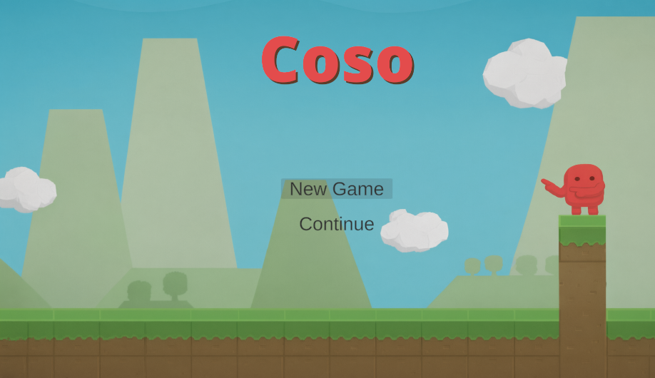
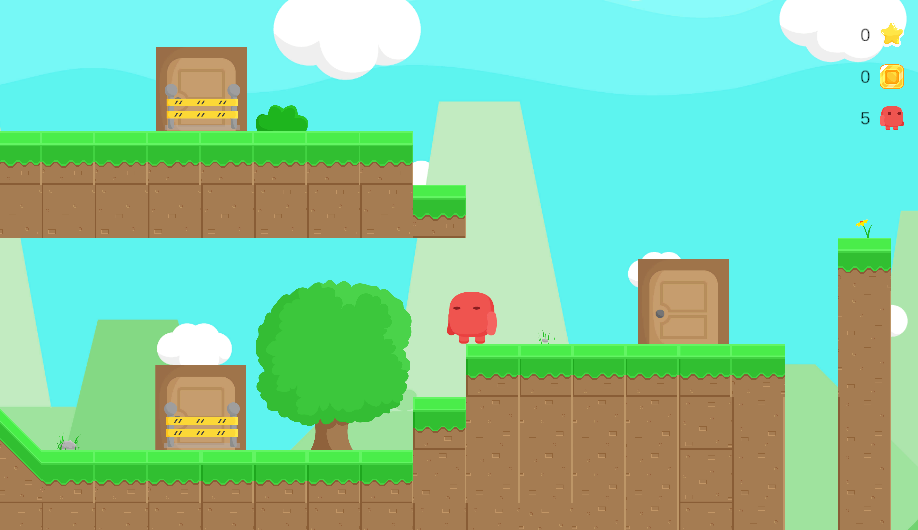
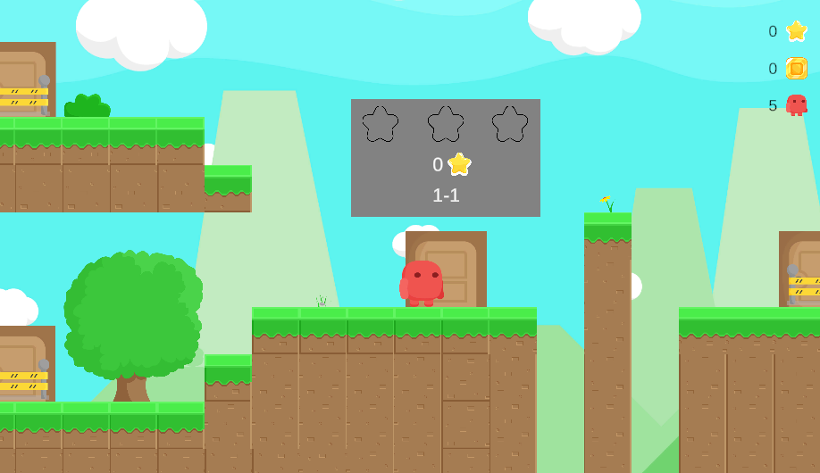
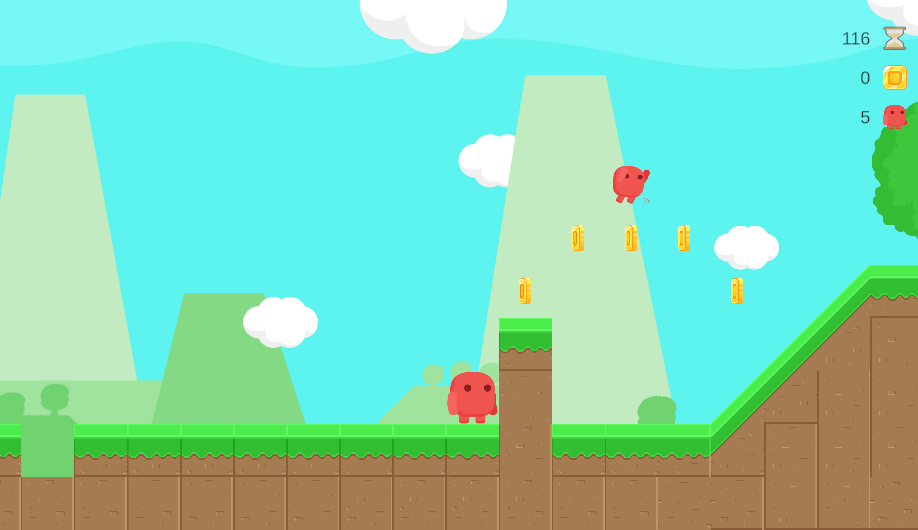
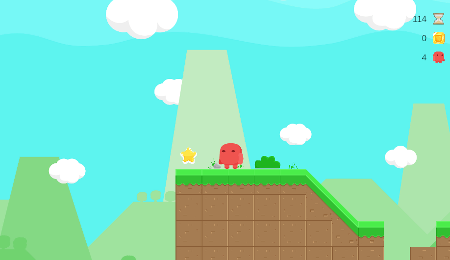
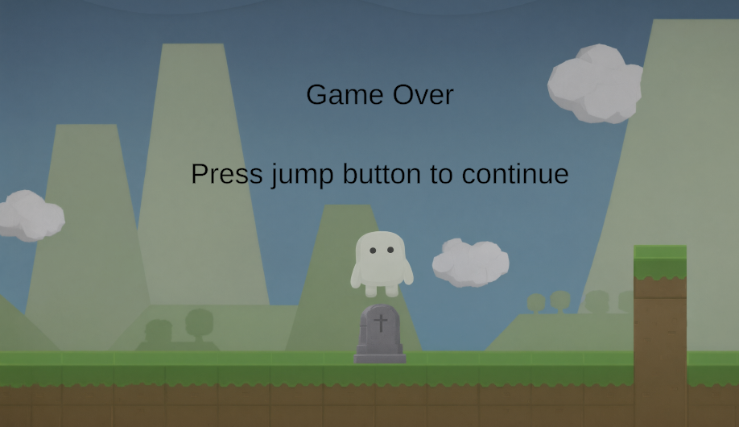

# Manual de usuario

## Menú principal

Se compone de 2 botones, uno para iniciar una partida nueva y otra para continuar la partida guardada.

## Mundo base

Mundo base es un mundo dentro del juego desde el cual puedes navegar a otros a través de unas puertas que te teletransportan a los niveles. Las puertas que tienes desbloqueada te salen sin valla.

Adicionalmente se indica el número de estrellas conseguidas, monedas y vidas que te quedan en la parte superior derecha.

Al ponerte dentro de una puerta esta te muestra info sobre que estrellas has obtenido de la misma, el nombre del nivel y la cantidad de estrellas que requiere aún que hayas completado el nivel previo para poder acceder a este nivel.

## Niveles
Los niveles albergan monedas que pueden ser obtenidas cuando llegas a 100 se resetea el contador y recibes una vida extra como recompensa. Adicionalmente cada nivel puede contener un power up que te permite realizar un doble salto y recibir un golpe de los enemigos antes de morir, pero a cambio pierdes este power up y vuelves a tu estado normal.

Los niveles tienen un límite de tiempo que al llegar a 0 pierdes una vida, el powerup y vuelves al mundo base.

Cada nivel alberga tres estrellas como las de la imagen para ser obtenidas en ubicaciones distintas y al conseguirlas puedes ir desbloqueando los niveles 1-5 a 1-8 siempre que tambien hayas completado el nivel previo.

# Has perdido

Esta pantalla salta cuando tu contador de vidas llega a 0 indicando que has perdido y restablece tu partida automáticamente y el contador de vidas a 5

