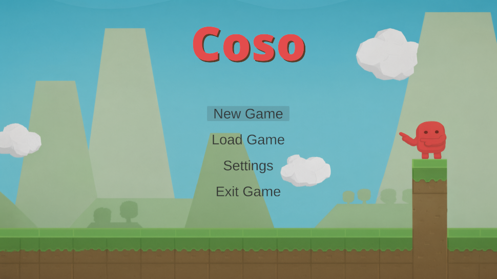
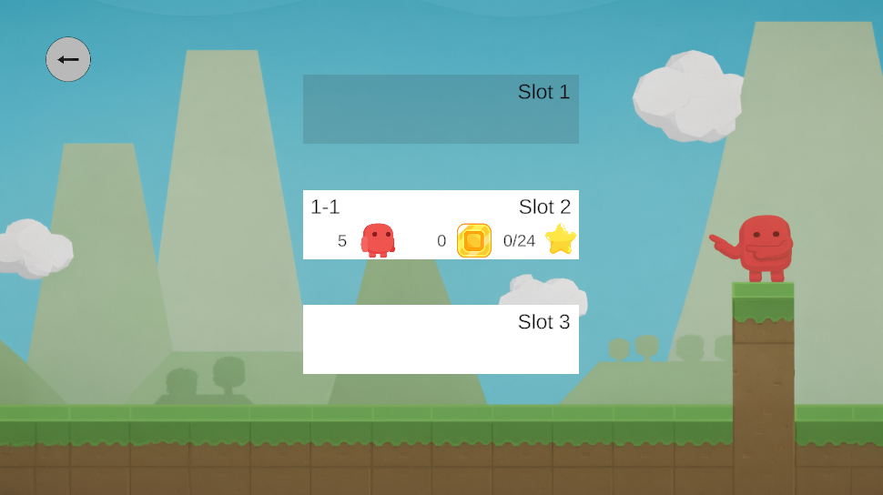
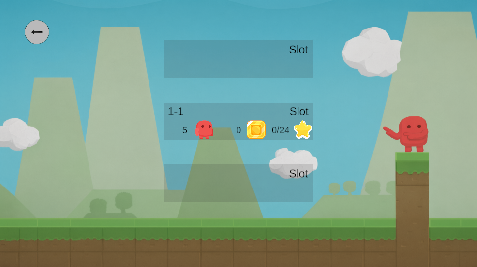
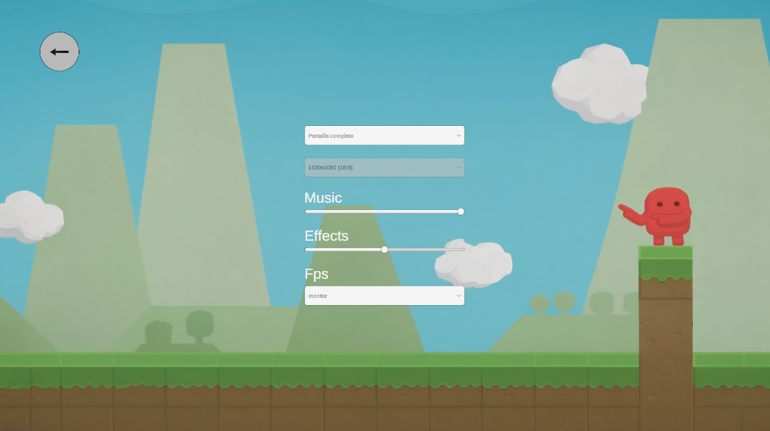
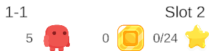
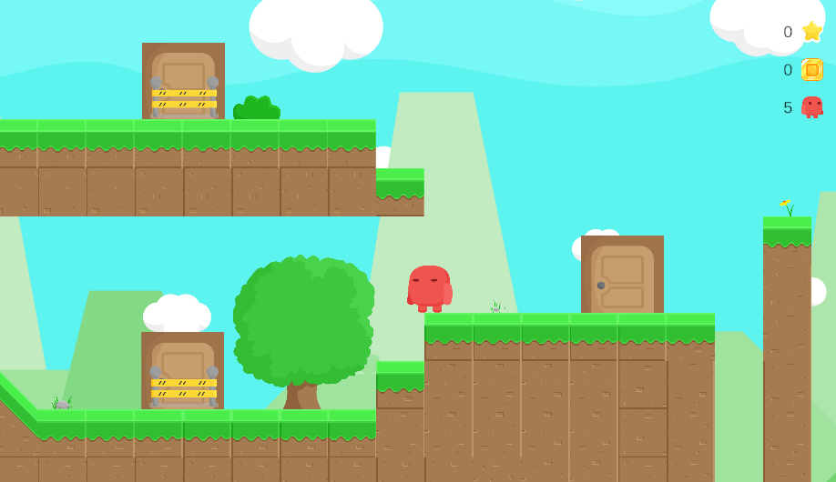
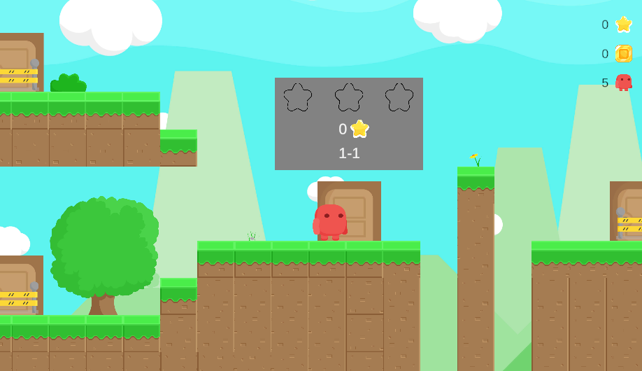
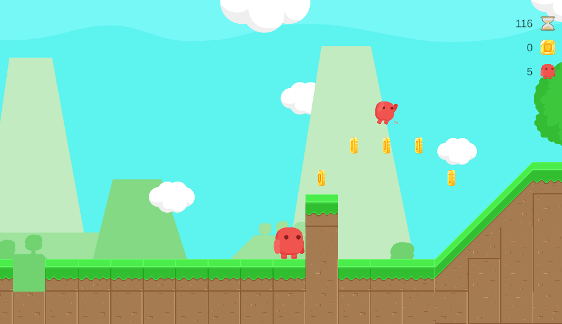
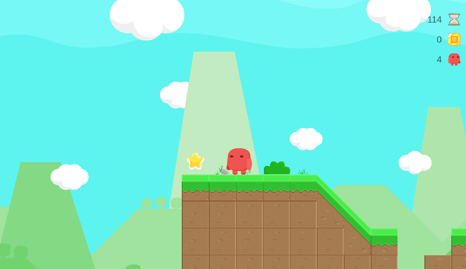
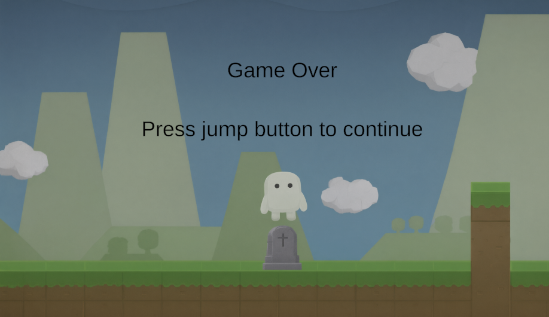

# Manual de usuario

## Menú principal

Se compone de 3-4 botones, el primero te permite crear una nueva partida, el segundo te permite cargar una partida existente, el tercero te permite cambiar ajustes del juego como el audio y por último salir del juego (solo disponible en windows, linux y mac).

### Nuevo juego

El primer botón ofrece 3 slots donde puedes almacenar tu partida. El primer slot es el que esta seleccionado, el segundo tiene una partida guardada que puede ser sobreescrita y el tercero puedes guardar partida, pero no esta seleccionado

### Cargar juego

Aqui se muestran nuevamente los 3 slots, pero los slots que no tienen partida vienen sin posibilidad de iteractuar y el primer slot con una partida es marcado (si, tiene la misma tonalidad que el deshabilitado)

### Ajustes

Permite hacer cambios en la configuración de juego tiene 3-5 opciones. La primera y segunda solo estan disponibles en windows, linux y mac donde puedes definir si jugar a pantalla completa o ventana y seleccionar la resolución. Estas se detectan a partir de las que soporta tu monitor. El audio de la música de fondo y los efectos que esta para todas las plataformas. Por último, puedes cambiar los fps objetivos, pero la configuración existente en tu dispositivo puedes sobreescribir estas modificaciones. Este comportamiento ha sido identificado en dispositivos android en ciertos modos de ahorro de energia.

### Partida guardada

El slot muestra un total de 4 valores relevantes de la partida. El primero consiste en el nivel en el cual se encuentra el jugador, el segundo el número de vidas actuales, las monedas actuales y finalmente la cantidad de estrellas que tiene recolectadas.

## Mundo base

Mundo base es un mundo dentro del juego desde el cual puedes navegar a otros a través de unas puertas que te teletransportan a los niveles. Las puertas que tienes desbloqueada te salen sin valla.

Adicionalmente se indica el número de estrellas conseguidas, monedas y vidas que te quedan en la parte superior derecha.

Al ponerte dentro de una puerta esta te muestra info sobre que estrellas has obtenido de la misma, el nombre del nivel y la cantidad de estrellas que requiere aún que hayas completado el nivel previo para poder acceder a este nivel.

## Niveles
Los niveles albergan monedas que pueden ser obtenidas cuando llegas a 100 se resetea el contador y recibes una vida extra como recompensa. Adicionalmente cada nivel puede contener un power up que te permite realizar un doble salto y recibir un golpe de los enemigos antes de morir, pero a cambio pierdes este power up y vuelves a tu estado normal.

Los niveles tienen un límite de tiempo que al llegar a 0 pierdes una vida, el powerup y vuelves al mundo base.

Cada nivel alberga tres estrellas como las de la imagen para ser obtenidas en ubicaciones distintas y al conseguirlas puedes ir desbloqueando los niveles 1-5 a 1-8 siempre que tambien hayas completado el nivel previo.

## Has perdido

Esta pantalla salta cuando tu contador de vidas llega a 0 indicando que has perdido y restablece tu partida automáticamente y el contador de vidas a 5

